# Diagramas Entidad-Relación (Mermaid) — Panadería Los Tres Spa

En este documento se respaldan los códigos fuente en formato Mermaid para la generación y actualización de los diagramas Entidad-Relación (MER) del sistema.

---

## 1. MER — Modelo de Dominio del Negocio (Versión Limpia)

Este diagrama representa exclusivamente las entidades operativas y reglas de negocio del software de la panadería, omitiendo las tablas administrativas por defecto de Django.

```mermaid
erDiagram

    %% ====================================================
    %% 1. USUARIOS Y PERFILES DE ACCESO
    %% ====================================================

    core_usuario {
        bigint id PK
        varchar_128 password
        datetime_6 last_login
        tinyint_1 is_superuser
        varchar_150 username
        varchar_150 first_name
        varchar_150 last_name
        varchar_254 email
        tinyint_1 is_staff
        tinyint_1 is_active
        datetime_6 date_joined
        varchar_20 rol
    }

    core_cliente {
        bigint id PK
        varchar_255 direccion
        varchar_20 telefono
        bigint user_id FK
    }

    core_cajero {
        bigint id PK
        int num_caja_asignada
        bigint user_id FK
    }

    core_administrador {
        bigint id PK
        varchar_50 nivel_acceso
        bigint user_id FK
    }

    core_puntosfidelizacion {
        bigint id PK
        int puntos_acumulados
        datetime_6 fecha_actualizacion
        bigint cliente_id FK
    }

    %% ====================================================
    %% 2. CATÁLOGO, PRODUCTOS, TURNOS Y RECETAS
    %% ====================================================

    core_categoria {
        bigint id PK
        varchar_100 nombre
        longtext descripcion
    }

    core_producto {
        bigint id PK
        varchar_150 nombre
        longtext descripcion
        decimal_10_2 precio
        int stock
        int stock_critico
        varchar_500 imagen_url
        tinyint_1 activo
        bigint categoria_id FK
        varchar_10 unidad_medida
        varchar_100 unidades_por_kg
    }

    core_turno {
        bigint id PK
        varchar_50 nombre
        time_6 hora_inicio
        time_6 hora_fin
        tinyint_1 lunes
        tinyint_1 martes
        tinyint_1 miercoles
        tinyint_1 jueves
        tinyint_1 viernes
        tinyint_1 sabado
        tinyint_1 domingo
        tinyint_1 activo
    }

    core_producto_turnos {
        bigint id PK
        bigint producto_id FK
        bigint turno_id FK
    }

    core_receta {
        bigint id PK
        varchar_150 nombre
        longtext descripcion
        bigint producto_id FK
    }

    core_ingredientereceta {
        bigint id PK
        decimal_10_3 cantidad
        bigint insumo_id FK
        bigint receta_id FK
    }

    %% ====================================================
    %% 3. MATERIAS PRIMAS, PROVEEDORES Y PRODUCCIÓN
    %% ====================================================

    core_insumo {
        bigint id PK
        varchar_20 codigo
        varchar_100 nombre
        varchar_50 tipo_insumo
        varchar_20 unidad_medida
        decimal_10_2 precio_unitario
        decimal_10_2 stock_actual
        decimal_10_2 stock_minimo
        int stock_sacos
        decimal_8_2 kilos_por_saco
        decimal_10_2 total_kg
        decimal_10_2 precio_saco
        varchar_150 proveedor_nombre
    }

    core_proveedor {
        bigint id PK
        varchar_12 rut
        varchar_150 nombre_proveedor
        varchar_254 email
        varchar_20 telefono
        varchar_255 direccion
        decimal_10_2 costo_flete
    }

    core_proveedorinsumo {
        bigint id PK
        decimal_10_2 precio_ofrecido
        bigint insumo_id FK
        bigint proveedor_id FK
    }

    core_producciondiaria {
        bigint id PK
        int cantidad
        datetime_6 fecha_produccion
        bigint producto_id FK
        bigint responsable_id FK
    }

    %% ====================================================
    %% 4. VENTAS E-COMMERCE (CARRITO, PEDIDOS Y PAGOS)
    %% ====================================================

    core_carrito {
        bigint id PK
        datetime_6 fecha_creacion
        bigint cliente_id FK
    }

    core_itemcarrito {
        bigint id PK
        int cantidad
        decimal_10_2 subtotal
        bigint carrito_id FK
        bigint producto_id FK
    }

    core_pedido {
        bigint id PK
        datetime_6 fecha
        varchar_50 estado
        varchar_50 canal
        varchar_50 tipo_entrega
        varchar_255 direccion_despacho
        decimal_10_2 total
        bigint cliente_id FK
    }

    core_detallepedido {
        bigint id PK
        int cantidad
        decimal_10_2 precio_unitario
        decimal_10_2 subtotal
        bigint pedido_id FK
        bigint producto_id FK
    }

    core_pago {
        bigint id PK
        decimal_10_2 monto
        varchar_50 metodo
        varchar_50 estado
        varchar_100 codigo_autorizacion
        datetime_6 fecha_pago
        bigint pedido_id FK
    }

    %% ====================================================
    %% 5. OPERACIÓN POS Y CAJA REGISTRADORA
    %% ====================================================

    core_caja {
        bigint id PK
        datetime_6 fecha_apertura
        datetime_6 fecha_cierre
        decimal_10_2 monto_inicial
        varchar_20 estado
        bigint cajero_id FK
    }

    core_cierrecaja {
        bigint id PK
        decimal_10_2 monto_inicial
        decimal_10_2 monto_ventas_sistema
        decimal_10_2 monto_contado
        decimal_10_2 diferencia
        varchar_50 estado_cuadratura
        datetime_6 fecha_cierre
        bigint caja_id FK
    }

    %% ====================================================
    %% RELACIONES DEL MODELO DE DOMINIO
    %% ====================================================

    %% Perfiles herederos de Usuario (1 a 1 opcional)
    core_usuario ||--o| core_cliente : "perfil_cliente"
    core_usuario ||--o| core_cajero : "perfil_cajero"
    core_usuario ||--o| core_administrador : "perfil_admin"

    %% Cliente y sus operaciones
    core_cliente ||--o| core_puntosfidelizacion : "acumula_puntos"
    core_cliente |o--o{ core_carrito : "abre_carrito"
    core_cliente |o--o{ core_pedido : "realiza_pedido"

    %% Operación de Caja POS
    core_cajero |o--o{ core_caja : "administra_caja"
    core_caja ||--o{ core_cierrecaja : "registra_cierre"

    %% Catálogo y Turnos
    core_categoria ||--o{ core_producto : "clasifica"
    core_producto ||--o{ core_producto_turnos : "asociado_a"
    core_turno ||--o{ core_producto_turnos : "aplica_en"

    %% Recetas e Insumos
    core_producto ||--o| core_receta : "elaborado_con"
    core_receta ||--o{ core_ingredientereceta : "requiere"
    core_insumo ||--o{ core_ingredientereceta : "usado_en"

    %% Proveedores e Insumos
    core_insumo ||--o{ core_proveedorinsumo : "cotizado_en"
    core_proveedor ||--o{ core_proveedorinsumo : "ofrece"

    %% Registro de Producción
    core_producto ||--o{ core_producciondiaria : "se_hornea"
    core_usuario |o--o{ core_producciondiaria : "registra_hornada"

    %% Carrito de Compras
    core_carrito ||--o{ core_itemcarrito : "contiene"
    core_producto ||--o{ core_itemcarrito : "agregado_a"

    %% Pedido, Detalle y Pago (1 a 1)
    core_pedido ||--o{ core_detallepedido : "desglosa"
    core_producto ||--o{ core_detallepedido : "incluido_en"
    core_pedido ||--|| core_pago : "se_cancela_con"
```

---

## 2. MER — Modelo Físico Completo (Base de Datos Real)

Este diagrama representa la totalidad de las 31 tablas creadas en la base de datos `panaderia_db` de MySQL, incluyendo autenticación, registros de auditoría y sesiones del framework Django.

```mermaid
erDiagram

    %% ====================================================
    %% 1. USUARIOS, PERFILES Y SEGURIDAD (CORE)
    %% ====================================================

    core_usuario {
        bigint id PK
        varchar_128 password
        datetime_6 last_login
        tinyint_1 is_superuser
        varchar_150 username
        varchar_150 first_name
        varchar_150 last_name
        varchar_254 email
        tinyint_1 is_staff
        tinyint_1 is_active
        datetime_6 date_joined
        varchar_20 rol
    }

    core_cliente {
        bigint id PK
        varchar_255 direccion
        varchar_20 telefono
        bigint user_id FK
    }

    core_cajero {
        bigint id PK
        int num_caja_asignada
        bigint user_id FK
    }

    core_administrador {
        bigint id PK
        varchar_50 nivel_acceso
        bigint user_id FK
    }

    core_puntosfidelizacion {
        bigint id PK
        int puntos_acumulados
        datetime_6 fecha_actualizacion
        bigint cliente_id FK
    }

    %% ====================================================
    %% 2. CATÁLOGO, PRODUCTOS, TURNOS Y RECETAS
    %% ====================================================

    core_categoria {
        bigint id PK
        varchar_100 nombre
        longtext descripcion
    }

    core_producto {
        bigint id PK
        varchar_150 nombre
        longtext descripcion
        decimal_10_2 precio
        int stock
        int stock_critico
        varchar_500 imagen_url
        tinyint_1 activo
        bigint categoria_id FK
        varchar_10 unidad_medida
        varchar_100 unidades_por_kg
    }

    core_turno {
        bigint id PK
        varchar_50 nombre
        time_6 hora_inicio
        time_6 hora_fin
        tinyint_1 lunes
        tinyint_1 martes
        tinyint_1 miercoles
        tinyint_1 jueves
        tinyint_1 viernes
        tinyint_1 sabado
        tinyint_1 domingo
        tinyint_1 activo
    }

    core_producto_turnos {
        bigint id PK
        bigint producto_id FK
        bigint turno_id FK
    }

    core_receta {
        bigint id PK
        varchar_150 nombre
        longtext descripcion
        bigint producto_id FK
    }

    core_ingredientereceta {
        bigint id PK
        decimal_10_3 cantidad
        bigint insumo_id FK
        bigint receta_id FK
    }

    %% ====================================================
    %% 3. MATERIAS PRIMAS, PROVEEDORES Y PRODUCCIÓN
    %% ====================================================

    core_insumo {
        bigint id PK
        varchar_20 codigo
        varchar_100 nombre
        varchar_50 tipo_insumo
        varchar_20 unidad_medida
        decimal_10_2 precio_unitario
        decimal_10_2 stock_actual
        decimal_10_2 stock_minimo
        int stock_sacos
        decimal_8_2 kilos_por_saco
        decimal_10_2 total_kg
        decimal_10_2 precio_saco
        varchar_150 proveedor_nombre
    }

    core_proveedor {
        bigint id PK
        varchar_12 rut
        varchar_150 nombre_proveedor
        varchar_254 email
        varchar_20 telefono
        varchar_255 direccion
        decimal_10_2 costo_flete
    }

    core_proveedorinsumo {
        bigint id PK
        decimal_10_2 precio_ofrecido
        bigint insumo_id FK
        bigint proveedor_id FK
    }

    core_producciondiaria {
        bigint id PK
        int cantidad
        datetime_6 fecha_produccion
        bigint producto_id FK
        bigint responsable_id FK
    }

    %% ====================================================
    %% 4. VENTAS E-COMMERCE (CARRITO, PEDIDOS Y PAGOS)
    %% ====================================================

    core_carrito {
        bigint id PK
        datetime_6 fecha_creacion
        bigint cliente_id FK
    }

    core_itemcarrito {
        bigint id PK
        int cantidad
        decimal_10_2 subtotal
        bigint carrito_id FK
        bigint producto_id FK
    }

    core_pedido {
        bigint id PK
        datetime_6 fecha
        varchar_50 estado
        varchar_50 canal
        varchar_50 tipo_entrega
        varchar_255 direccion_despacho
        decimal_10_2 total
        bigint cliente_id FK
    }

    core_detallepedido {
        bigint id PK
        int cantidad
        decimal_10_2 precio_unitario
        decimal_10_2 subtotal
        bigint pedido_id FK
        bigint producto_id FK
    }

    core_pago {
        bigint id PK
        decimal_10_2 monto
        varchar_50 metodo
        varchar_50 estado
        varchar_100 codigo_autorizacion
        datetime_6 fecha_pago
        bigint pedido_id FK
    }

    %% ====================================================
    %% 5. OPERACIÓN POS Y CAJA REGISTRADORA
    %% ====================================================

    core_caja {
        bigint id PK
        datetime_6 fecha_apertura
        datetime_6 fecha_cierre
        decimal_10_2 monto_inicial
        varchar_20 estado
        bigint cajero_id FK
    }

    core_cierrecaja {
        bigint id PK
        decimal_10_2 monto_inicial
        decimal_10_2 monto_ventas_sistema
        decimal_10_2 monto_contado
        decimal_10_2 diferencia
        varchar_50 estado_cuadratura
        datetime_6 fecha_cierre
        bigint caja_id FK
    }

    %% ====================================================
    %% 6. TABLAS INTERNAS Y AUTENTICACIÓN DJANGO (AUTH & SYSTEM)
    %% ====================================================

    auth_group {
        int id PK
        varchar_150 name
    }

    auth_permission {
        int id PK
        varchar_255 name
        int content_type_id FK
        varchar_100 codename
    }

    auth_group_permissions {
        bigint id PK
        int group_id FK
        int permission_id FK
    }

    core_usuario_groups {
        bigint id PK
        bigint usuario_id FK
        int group_id FK
    }

    core_usuario_user_permissions {
        bigint id PK
        bigint usuario_id FK
        int permission_id FK
    }

    django_content_type {
        int id PK
        varchar_100 app_label
        varchar_100 model
    }

    django_admin_log {
        int id PK
        datetime_6 action_time
        longtext object_id
        varchar_200 object_repr
        smallint_unsigned action_flag
        longtext change_message
        int content_type_id FK
        bigint user_id FK
    }

    django_migrations {
        bigint id PK
        varchar_255 app
        varchar_255 name
        datetime_6 applied
    }

    django_session {
        varchar_40 session_key PK
        longtext session_data
        datetime_6 expire_date
    }

    %% ====================================================
    %% RELACIONES DEL MODELO FÍSICO COMPLETO
    %% ====================================================

    %% Perfiles y Usuarios
    core_usuario ||--o| core_cliente : "perfil_cliente"
    core_usuario ||--o| core_cajero : "perfil_cajero"
    core_usuario ||--o| core_administrador : "perfil_admin"

    %% Cliente
    core_cliente ||--o| core_puntosfidelizacion : "acumula_puntos"
    core_cliente |o--o{ core_carrito : "posee_carrito"
    core_cliente |o--o{ core_pedido : "realiza_pedido"

    %% Caja y POS
    core_cajero |o--o{ core_caja : "opera_caja"
    core_caja ||--o{ core_cierrecaja : "audita_cierre"

    %% Catálogo, Turnos y Recetas
    core_categoria ||--o{ core_producto : "clasifica"
    core_producto ||--o{ core_producto_turnos : "asignado_a"
    core_turno ||--o{ core_producto_turnos : "aplica_en"
    core_producto ||--o| core_receta : "elaborado_con"
    core_receta ||--o{ core_ingredientereceta : "requiere"
    core_insumo ||--o{ core_ingredientereceta : "usado_como_ingrediente"

    %% Proveedores e Insumos
    core_insumo ||--o{ core_proveedorinsumo : "cotizado_en"
    core_proveedor ||--o{ core_proveedorinsumo : "suministra"

    %% Producción
    core_producto ||--o{ core_producciondiaria : "se_hornea"
    core_usuario |o--o{ core_producciondiaria : "registra_hornada"

    %% Carrito
    core_carrito ||--o{ core_itemcarrito : "contiene"
    core_producto ||--o{ core_itemcarrito : "agregado_en"

    %% Ventas y Pago
    core_pedido ||--o{ core_detallepedido : "desglosa"
    core_producto ||--o{ core_detallepedido : "vendido_en"
    core_pedido ||--|| core_pago : "se_cancela_con"

    %% Framework Django Auth & Security
    core_usuario ||--o{ core_usuario_groups : "pertenece_a_grupo"
    auth_group ||--o{ core_usuario_groups : "grupo_asignado"

    core_usuario ||--o{ core_usuario_user_permissions : "posee_permiso"
    auth_permission ||--o{ core_usuario_user_permissions : "permiso_directo"

    auth_group ||--o{ auth_group_permissions : "contiene_permisos"
    auth_permission ||--o{ auth_group_permissions : "otorgado_a_grupo"

    django_content_type ||--o{ auth_permission : "define_modelo_de_permiso"
    django_content_type |o--o{ django_admin_log : "registra_modelo_modificado"
    core_usuario ||--o{ django_admin_log : "registra_accion_admin"
```

